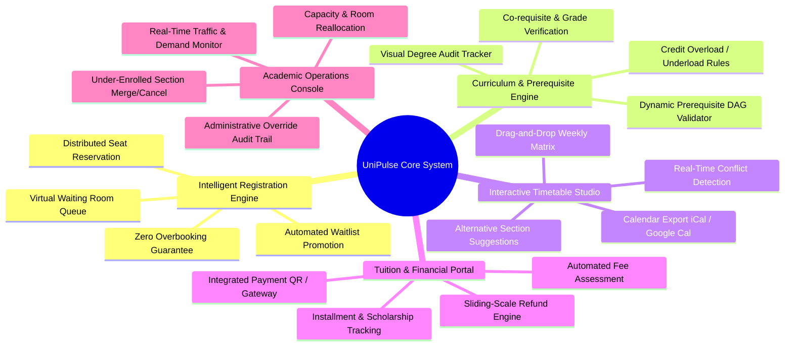

# Vision and Scope Document
## Project: UniPulse - Modernized Campus Academic & Registration Platform
**Course:** SWR302 - Software Requirements Engineering  
**Class:** SE2059-NJ | **Team:** Assignment Group 4  
**Framework:** Karl E. Wiegers & Joy Beatty (*Software Requirements*, 3rd Edition, Chapter 5)  
**Date:** Fall Semester 2026 | **Status:** Approved Baseline  

---

## 1. Business Requirements (Yêu cầu Nghiệp vụ)

### 1.1. Background (Bối cảnh thực tiễn)
Higher education institutions serve tens of thousands of undergraduate and postgraduate students. Academic operations—specifically semester course registration, timetable construction, tuition billing, prerequisite validation, and academic progress tracking—represent the core operational backbone of university governance.

Historically, universities (such as FPT University with its legacy FAP portal and similar monolithic SIS platforms) have relied on centralized, relational client-server architectures built over a decade ago. While functioning adequately during normal mid-semester operations, these systems suffer from catastrophic service degradation during the bi-annual course registration period:
1. **Traffic Spikes & Severe Degradation:** At exact registration trigger moments (e.g., 09:00:00 or 12:00:00), 15,000 to 30,000 concurrent students storm the portal within a 90-second window. This creates acute database connection pool exhaustion, unindexed locking deadlocks, and frequent HTTP 504 Gateway Timeouts.
2. **Data Inconsistency & Race Conditions:** Inadequate concurrency isolation leads to "overselling" class seats (e.g., 42 students admitted into a 30-seat computer laboratory) or ghost reservations where dropped seats remain locked indefinitely.
3. **High Administrative Overhead:** Academic office staff (Phòng Đào tạo) spend over 400 manual person-hours per semester resolving registration disputes, manually opening override sections, adjusting under-enrolled classes, and correcting prerequisite bypass errors.
4. **Sub-optimal Student Experience:** Students lack visual schedule conflict resolution, cannot visualize degree completion pathways, and suffer anxiety from opaque, lottery-like portal crashes.

### 1.2. Business Opportunity (Cơ hội Kinh doanh & Giá trị cốt lõi)
Modernizing the academic and registration engine through **UniPulse** transforms the registration experience from a source of institutional frustration into a seamless, equitable, and transparent self-service workflow. By adopting an event-driven, distributed caching architecture (Redis-backed atomic reservation) combined with an intuitive responsive user interface, the university will achieve:
- Elimination of server downtime during registration rush hours.
- 100% data integrity with zero seat overselling.
- Transparent real-time visibility into student demand, enabling proactive faculty scheduling and classroom capacity optimization.

### 1.3. Business Objectives and Success Criteria (Mục tiêu Kinh doanh & Tiêu chí Đo lường)

| Objective ID | Business Objective Description | Baseline (Legacy System) | Target Metric (UniPulse) | Measurement Method |
|:---:|:---|:---:|:---:|:---|
| **BO-1** | Eliminate registration system outages during peak registration windows. | Mean Downtime: 45–120 minutes per registration cycle | **Zero unplanned downtime (99.99% system availability)** | APM (Application Performance Monitoring) server telemetry logs. |
| **BO-2** | Guarantee strict transactional integrity in course capacity allocation. | 3.5% overbooking error rate (oversold lab/lecture slots) | **0.00% overbooking rate (Mathematically guaranteed zero overselling)** | Database consistency audit comparing section capacity against active enrollments. |
| **BO-3** | Reduce latency of course registration requests during peak traffic. | Average response time: 8.5s - 18.0s (P95) with high timeout rate | **Sub-second response time: P95 < 800ms; P99 < 1,500ms** under 25,000 concurrent users | Load testing (k6 / JMeter) and real-time Prometheus latency metrics. |
| **BO-4** | Accelerate registration cycle completion for the student body. | Average student completion time: 42 minutes (due to retries/crashes) | **Average student completion time < 4 minutes** | End-to-end session duration analytics from login to final enrollment confirmation. |
| **BO-5** | Reduce administrative workload for Academic Registrar staff. | Over 400 person-hours spent on manual overrides and course adjustments | **Reduction of manual administrative intervention by >= 75%** | Registrar ticket tracking system and override log volume. |
| **BO-6** | Automate class section viability and room resource optimization. | 5 business days post-registration to identify under-enrolled classes | **Real-time automated alerting for classes under minimum capacity (15 students)** | Daily administrative operational summary dashboard. |

### 1.4. Customer and Market Needs (Nhu cầu của Khách hàng và Người dùng)
- **For Students:**
  - Fast, responsive, mobile-friendly interface accessible from any browser or device.
  - Interactive weekly schedule builder with automatic visual conflict detection.
  - Instant degree audit visualization showing completed, in-progress, and remaining prerequisite chains.
  - Transparent waitlist mechanism with real-time queue position tracking.
  - Seamless tuition computation and multi-channel instant online payment (VNPay, VietQR, Momo).
- **For Academic Registrar Staff (Phòng Đào tạo):**
  - Live demand analytics dashboard showing real-time fill rates across all courses.
  - Automated threshold alerts for classes under minimum enrollment (<15 students) or waitlists exceeding split thresholds (>=20 students).
  - Bulk section management tools (split, merge, cancel, reassign room/lecturer).
  - Configurable registration windows by student cohort, GPA standing, and major.
- **For Faculty Lecturers:**
  - Real-time class rosters with student profile pictures and academic contact information.
  - Dynamic attendance and grade entry portal synchronized directly with student academic records.
- **For University Leadership:**
  - Data-driven institutional reporting on curriculum demand, faculty utilization, and classroom occupancy rates.

### 1.5. Business Risks (Rủi ro Kinh doanh & Phương án Giảm thiểu)

| Risk ID | Risk Description | Probability | Impact | Mitigation Strategy |
|:---:|:---|:---:|:---:|:---|
| **BR-R01** | Student frustration due to unfair bot usage or automated registration scripting. | High | High | Implement Cloudflare Turnstile CAPTCHA, cryptographic registration nonce tokens, and API rate limiting per student account. |
| **BR-R02** | Resistance from legacy administrative staff accustomed to manual paper/Excel workflows. | Medium | Medium | Conduct phased training workshops, role-based user documentation, and maintain one-click export/import interoperability with existing Excel reporting formats. |
| **BR-R03** | Upstream third-party payment gateway latency or downtime during tuition settlement. | Medium | High | Decouple seat reservation from final payment settlement: grant a 24-hour provisional enrollment hold, providing payment retry tolerance without dropping student seats. |
| **BR-R04** | Incomplete or inconsistent historical prerequisite data migrated from legacy databases. | Medium | High | Implement an automated schema migration verification tool and an advisor override portal with mandatory audit logging. |

---

## 2. Vision of the Solution (Tầm nhìn Giải pháp)

### 2.1. Vision Statement (Tuyên ngôn Tầm nhìn)
> **For** university students, faculty, and academic administrators  
> **Who** require a reliable, transparent, and frictionless course registration and academic management experience,  
> **The UniPulse Platform**  
> **Is** an enterprise cloud-native academic operations and intelligent registration system  
> **That** delivers sub-second registration response times under massive concurrency, automates complex prerequisite evaluation, provides visual schedule conflict detection, and guarantees zero seat overbooking.  
> **Unlike** legacy university portals (such as FAP/EduSoft) plagued by server crashes, ambiguous business rules, and high administrative friction,  
> **Our product** features a distributed in-memory reservation engine, virtual traffic throttling queues, an interactive schedule planner, and automated degree audit analytics.

### 2.2. Major Features (Các Tính năng Chính)

- **FEAT-1: Distributed High-Concurrency Registration Engine:** Real-time seat hold allocation leveraging Redis Lua atomic decrements, token bucket rate limiting, and virtual waiting queue during extreme traffic.
- **FEAT-2: Prerequisite & Degree Audit Verification Graph:** Directed Acyclic Graph (DAG) validator evaluating completed course grades, co-requisites, and major-specific graduation requirements in real time.
- **FEAT-3: Visual Schedule Planner & Conflict Matrix:** Interactive 7-day schedule grid providing sub-millisecond collision detection across time slots, exam periods, and classroom physical locations.
- **FEAT-4: Dynamic Waitlist & Auto-Promotion Service:** Automated FIFO queue promoting waitlisted students when seats are vacated, with timed reservation acceptance windows.
- **FEAT-5: Financial & Tuition Settlement Gateway:** Dynamic credit-hour fee calculation, real-time banking integration (VietQR/VNPay), and policy-enforced refund calculations.
- **FEAT-6: Academic Operations Control Center:** Real-time administrative dashboard showing section occupancy heatmaps, under-enrollment warnings, and one-click section split/merge tools.

### 2.3. Assumptions and Dependencies (Giả định và Phụ thuộc)
- **Assumptions:**
  - Students possess internet-connected computing devices (smartphones, tablets, laptops) with modern web browsers (Chrome, Edge, Safari, Firefox).
  - The university IT department provides access to the student identity directory via standard OAuth2 / OpenID Connect (e.g., Google Workspace for Education / Microsoft Entra ID).
  - Curricula, course syllabi, and prerequisite rules are structured in machine-readable formats.
- **Dependencies:**
  - Availability and SLA of university Single Sign-On (SSO) identity provider.
  - SLA of authorized banking payment gateways (VNPay / VietQR) for transaction confirmation webhooks.
  - University academic calendar dates (registration window start/end times, drop deadlines).

---

## 3. Scope and Limitations (Phạm vi và Giới hạn)

### 3.1. Scope of Initial Release (Phạm vi Phiên bản 1.0 - MVP)
The initial release concentrates on delivering an unshakeable, rock-solid course registration experience and core administrative management:
- Secure Single Sign-On (SSO) authentication with Student, Lecturer, Academic Staff, and Admin roles.
- Interactive Course Catalog with search, filters (faculty, credit, department), and syllabus preview.
- Prerequisite validation engine for all core and elective undergraduate courses.
- Weekly visual schedule builder with real-time time conflict detection.
- Distributed course registration engine supporting up to 25,000 concurrent students with Redis atomic reservation and zero overselling.
- Waitlist management with FIFO queue ordering and automated notification.
- Basic Degree Audit showing progress toward graduation.
- Tuition fee calculation and simulated instant banking QR payment integration.
- Academic staff console for section capacity adjustment, section status toggle (Open/Close), and real-time enrollment telemetry.

### 3.2. Scope of Subsequent Releases (Phạm vi các Phiên bản Tiếp theo)
- **Release 2.0:**
  - AI-powered personalized schedule generator (automatically generating clash-free schedules optimized for student commute or work preferences).
  - Native iOS and Android mobile applications with push notifications for waitlist seat openings.
  - Direct integration with University Learning Management System (Canvas / Moodle) for automatic roster synchronization.
  - Advanced graduation pathway simulation (what-if scenarios for minor degrees and major changes).
- **Release 3.0:**
  - Predictive enrollment forecasting using historical grade and registration data to recommend faculty hiring and classroom allocation 6 months in advance.

### 3.3. Limitations and Exclusions (Giới hạn và Các phần Không thuộc Phạm vi)
- The system will **not** manage physical dormitory/housing reservations.
- The system will **not** replace the full Human Resources (HR) and payroll processing system for faculty salaries.
- The system does **not** conduct proctored computer-based online examinations (which remains under dedicated exam software such as EOS / Safe Exam Browser).

---

## 4. Business Context (Bối cảnh Kinh doanh)

### 4.1. Stakeholder Profiles (Hồ sơ Các bên Liên quan)

| Stakeholder | User Class | Responsibilities & Primary Interests | Pain Points with Current System |
|:---|:---|:---|:---|
| **Undergraduate & Graduate Students** | Primary End-User | Search courses, plan timetable, enroll in sections, track degree progress, pay tuition. | Frustration with portal crashes, losing slots to bots, lack of visibility into waitlists. |
| **Academic Registrar Staff (Phòng Đào tạo)** | Primary Operator | Manage course catalogs, configure registration schedules, balance class sizes, resolve student appeals. | Overwhelmed with manual student emails, paper forms, and post-registration cleanup. |
| **Department Chairs & Deans (Chủ nhiệm Bộ môn / Trưởng khoa)** | Decision Maker | Monitor program enrollment trends, assign qualified lecturers, approve capacity overrides. | Lack of real-time visibility into unmet course demand before semester starts. |
| **Faculty Lecturers** | Secondary User | View class rosters, access student academic backgrounds, enter grades. | Unannounced class cancellations and outdated rosters distributed via email. |
| **Bursar / Finance Staff (Phòng Tài chính)** | Financial Operator | Monitor tuition reconciliation, manage scholarship discounts, approve refund requests. | Discrepancies between enrolled credits and collected tuition due to late drop changes. |
| **System Administrators / DevOps** | Technical Custodian | Maintain server infrastructure, manage database backups, ensure 99.99% uptime and security. | Panic over unannounced server outages, memory leaks, and unresponsive database pools during peak rush. |

### 4.2. Project Priorities Matrix (Ma trận Ưu tiên Dự án - Karl Wiegers Framework)

According to Karl Wiegers' project priority dimensions (*Constraint, Driver, Degree of Freedom*):

| Dimension | Constraint (Ràng buộc bắt buộc) | Driver (Động lực thành công chính) | Degree of Freedom (Mức độ linh hoạt) |
|:---|:---:|:---:|:---:|
| **Schedule (Tiến độ)** | | **X** (Must deploy prior to Fall 2026 semester registration window) | |
| **Features (Tính năng)** | | | **X** (Advanced AI schedule generator can be deferred to Phase 2) |
| **Quality (Chất lượng)** | **X** (Zero seat overbooking, sub-second latency, zero data loss are non-negotiable) | | |
| **Staff / Cost (Nhân sự & Chi phí)** | **X** (Fixed team of 5 software engineering students for SWR302 assignment) | | |

---

*End of Vision and Scope Document - UniPulse Platform*
