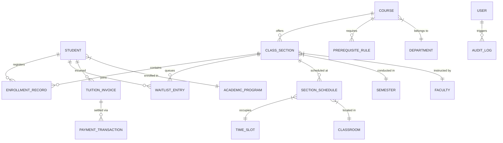

# Data Requirements and Data Dictionary
## UniPulse: Next-Generation Campus Academic & Intelligent Registration Platform
**Course:** SWR302 - Software Requirements Engineering  
**Class:** SE2059-NJ | **Team:** Assignment Group 4  
**Pedagogical Guidance:** Karl E. Wiegers & Joy Beatty (*Software Requirements*, 3rd Edition, Chapter 13)  
**Standard:** Relational Logical Data Model & Enterprise Data Dictionary  

---

## 1. Conceptual & Logical Data Model (Entity-Relationship Overview)

The UniPulse academic data model handles high-frequency transactional writes (seat reservations) while providing optimized read-paths for complex prerequisite graph traversal and degree audit analytics.

---

## 2. Comprehensive Data Dictionary (Từ điển Dữ liệu Chi tiết)

### 2.1 Entity: `STUDENTS`
*Description:* Represents university students actively pursuing undergraduate or graduate degree credentials.

| Field Name | Physical Column | Data Type | Nullable | Key | Constraints / Allowed Values | Description |
|:---|:---|:---|:---:|:---:|:---|:---|
| Student ID | `student_id` | VARCHAR(12) | NO | PK | Pattern: `^[A-Z]{2}[0-9]{6}$` (e.g. `SE180123`) | Unique university student roll number. |
| User Account ID | `user_id` | UUID | NO | FK | References `USERS(user_id)` | Link to central SSO user identity. |
| Full Name | `full_name` | VARCHAR(100) | NO | | Max length 100 characters | Student legal full name. |
| Academic Major | `program_id` | VARCHAR(10) | NO | FK | References `ACADEMIC_PROGRAMS(program_id)` | Enrolled degree curriculum. |
| Cohort Year | `cohort` | INT | NO | | Range: 2020 to 2030 (e.g., K18 = 2022) | Admission matriculation cohort. |
| Earned Credits | `earned_credits` | SMALLINT | NO | | $\ge 0$, Default: 0 | Total passed credits toward degree. |
| Cumulative GPA | `cgpa` | NUMERIC(3,2) | NO | | Range: 0.00 to 4.00, Default: 0.00 | Overall grade point average. |
| Academic Standing | `academic_standing`| VARCHAR(20) | NO | | `GOOD`, `WARNING_1`, `PROBATION`, `SUSPENDED` | Evaluated standing (BR-ACAD-001). |
| Overload Approval | `is_overload_approved`| BOOLEAN | NO | | Default: `FALSE` | Flag for 24-credit registration privilege. |
| Financial Hold | `has_financial_hold` | BOOLEAN | NO | | Default: `FALSE` | Restricts registration if true. |

---

### 2.2 Entity: `COURSES`
*Description:* The master catalog of academic courses approved by the university academic board.

| Field Name | Physical Column | Data Type | Nullable | Key | Constraints / Allowed Values | Description |
|:---|:---|:---|:---:|:---:|:---|:---|
| Course Code | `course_code` | VARCHAR(10) | NO | PK | Format: `^[A-Z]{3}[0-9]{3}$` (e.g., `SWR302`) | Official departmental course code. |
| Course Title | `course_title` | VARCHAR(150) | NO | | Non-empty string | Full title of the course. |
| Credit Units | `credits` | SMALLINT | NO | | Range: 1 to 6 (Standard = 3) | Academic credit hour weighting. |
| Department ID | `department_id` | VARCHAR(10) | NO | FK | References `DEPARTMENTS(department_id)` | Academic governing department. |
| Lecture Hours | `lecture_hours` | SMALLINT | NO | | $\ge 0$ | Total contact lecture hours per semester. |
| Lab Hours | `lab_hours` | SMALLINT | NO | | $\ge 0$ | Practical computer/laboratory hours. |
| Syllabus URL | `syllabus_url` | VARCHAR(255) | YES | | Valid HTTP/HTTPS URI | Link to detailed course syllabus document. |
| Is Active | `is_active` | BOOLEAN | NO | | Default: `TRUE` | Soft-deletion flag for retired courses. |

---

### 2.3 Entity: `PREREQUISITE_RULES`
*Description:* Directed relationship defining course dependency constraints and corequisites.

| Field Name | Physical Column | Data Type | Nullable | Key | Constraints / Allowed Values | Description |
|:---|:---|:---|:---:|:---:|:---|:---|
| Rule ID | `rule_id` | BIGSERIAL | NO | PK | Auto-incrementing integer | Unique prerequisite rule identifier. |
| Target Course | `target_course_code` | VARCHAR(10) | NO | FK | References `COURSES(course_code)` | The course requiring the prerequisite. |
| Prereq Course | `prereq_course_code` | VARCHAR(10) | NO | FK | References `COURSES(course_code)` | The required precursor course. |
| Relationship Type | `rule_type` | VARCHAR(20) | NO | | `PREREQUISITE`, `COREQUISITE`, `PRE_OR_CO` | Relationship classification (BR-PRE-002). |
| Minimum Grade | `min_grade` | NUMERIC(3,1) | NO | | Default: 5.0 (Scale 0.0 to 10.0) | Passing grade threshold (BR-PRE-001). |

---

### 2.4 Entity: `CLASS_SECTIONS`
*Description:* Specific instances of courses scheduled with assigned instructors, classrooms, and time slots for an active academic semester.

| Field Name | Physical Column | Data Type | Nullable | Key | Constraints / Allowed Values | Description |
|:---|:---|:---|:---:|:---:|:---|:---|
| Section ID | `section_id` | BIGSERIAL | NO | PK | Auto-incrementing primary key | Unique physical section identifier. |
| Section Code | `section_code` | VARCHAR(15) | NO | | Unique per course/term (e.g., `SWR302-SE1804`) | User-facing section identifier. |
| Course Code | `course_code` | VARCHAR(10) | NO | FK | References `COURSES(course_code)` | Target course. |
| Semester ID | `semester_id` | VARCHAR(10) | NO | FK | References `SEMESTERS(semester_id)` | Term in which class takes place. |
| Faculty ID | `faculty_id` | VARCHAR(12) | YES | FK | References `FACULTY(faculty_id)` | Assigned teaching professor. |
| Max Capacity | `max_capacity` | SMALLINT | NO | | Range: 15 to 45 (Standard = 35) | Maximum seating limit (BR-CAP-001). |
| Enrolled Count | `enrolled_count` | SMALLINT | NO | | $0 \le \text{count} \le \text{max\_capacity}$, Default: 0 | Number of officially enrolled students. |
| Waitlist Depth | `waitlist_count`| SMALLINT | NO | | $0 \le \text{count} \le 12$, Default: 0 | Active students on waitlist. |
| Section Status | `section_status`| VARCHAR(20) | NO | | `PLANNED`, `OPEN`, `FULL`, `CANCELLED` | Operational status of section. |
| Version (Lock) | `version` | BIGINT | NO | | Default: 0, increments on update | Optimistic locking token for concurrency. |

---

### 2.5 Entity: `ENROLLMENT_RECORDS`
*Description:* The core transactional record linking a student to an enrolled class section.

| Field Name | Physical Column | Data Type | Nullable | Key | Constraints / Allowed Values | Description |
|:---|:---|:---|:---:|:---:|:---|:---|
| Enrollment ID | `enrollment_id` | UUID | NO | PK | Universally Unique Identifier | Deterministic registration receipt ID. |
| Student ID | `student_id` | VARCHAR(12) | NO | FK | References `STUDENTS(student_id)` | Student enrolled in section. |
| Section ID | `section_id` | BIGINT | NO | FK | References `CLASS_SECTIONS(section_id)` | Enrolled class section. |
| Enrollment State| `status` | VARCHAR(20) | NO | | `RESERVED`, `ENROLLED`, `DROPPED`, `COMPLETED` | Registration lifecycle state. |
| Registered At | `registered_at` | TIMESTAMPTZ | NO | | ISO 8601 UTC timestamp | Exact moment registration was committed. |
| Dropped At | `dropped_at` | TIMESTAMPTZ | YES | | ISO 8601 UTC timestamp | Timestamp of drop action if applicable. |
| Final Grade | `final_grade` | NUMERIC(4,2) | YES | | Range: 0.00 to 10.00 | Earned academic grade at term end. |
| Transaction Hash| `tx_hash` | VARCHAR(64) | NO | | SHA-256 hash | Nonce proving enrollment integrity. |

---

### 2.6 Entity: `WAITLIST_ENTRIES`
*Description:* Manages sequential overflow queues for at-capacity class sections.

| Field Name | Physical Column | Data Type | Nullable | Key | Constraints / Allowed Values | Description |
|:---|:---|:---|:---:|:---:|:---|:---|
| Waitlist ID | `waitlist_id` | BIGSERIAL | NO | PK | Auto-incrementing identifier | Unique queue ticket identifier. |
| Student ID | `student_id` | VARCHAR(12) | NO | FK | References `STUDENTS(student_id)` | Queued student. |
| Section ID | `section_id` | BIGINT | NO | FK | References `CLASS_SECTIONS(section_id)` | Desired class section. |
| Queue Position | `position` | SMALLINT | NO | | $\ge 1$ (1 = Head of queue) | Relative FIFO order (BR-WAIT-001). |
| Status | `waitlist_status`| VARCHAR(15) | NO | | `QUEUED`, `OFFERED`, `ACCEPTED`, `EXPIRED` | Waitlist progression state. |
| Joined At | `joined_at` | TIMESTAMPTZ | NO | | High-resolution timestamp | Timestamp establishing queue priority. |
| Offer Expires At| `offer_expires_at`|TIMESTAMPTZ| YES | | Null unless status is `OFFERED` | 12-hour expiration deadline (BR-WAIT-002).|

---

### 2.7 Entity: `TUITION_INVOICES` & `PAYMENT_TRANSACTIONS`
*Description:* Financial records detailing semester tuition liabilities and electronic payment settlements.

| Field Name | Physical Column | Data Type | Nullable | Key | Constraints / Allowed Values | Description |
|:---|:---|:---|:---:|:---:|:---|:---|
| Invoice ID | `invoice_id` | VARCHAR(20) | NO | PK | Format: `INV-YYYY-XXXXX` | Official university tuition invoice ID. |
| Student ID | `student_id` | VARCHAR(12) | NO | FK | References `STUDENTS(student_id)` | Billable student. |
| Semester ID | `semester_id` | VARCHAR(10) | NO | FK | References `SEMESTERS(semester_id)` | Applicable academic term. |
| Total Assessed | `total_amount` | NUMERIC(12,2)| NO | | Currency in VND ($\ge 0$) | Assessed fee based on registered credits. |
| Paid Amount | `paid_amount` | NUMERIC(12,2)| NO | | Currency in VND, Default: 0.00 | Total reconciled payment received. |
| Payment Status | `payment_status`| VARCHAR(15) | NO | | `UNPAID`, `PARTIAL`, `PAID`, `REFUNDED` | Current settlement status. |
| Due Date | `due_date` | DATE | NO | | Calendar date | Official tuition fee settlement deadline. |

---

### 2.8 Entity: `AUDIT_LOGS`
*Description:* Immutable security and administrative event ledger guaranteeing total operational traceability.

| Field Name | Physical Column | Data Type | Nullable | Key | Constraints / Allowed Values | Description |
|:---|:---|:---|:---:|:---:|:---|:---|
| Log ID | `log_id` | UUID | NO | PK | System-generated UUID | Unique audit record identifier. |
| Actor ID | `actor_id` | VARCHAR(50) | NO | | Email or User ID of actor | Who performed the action. |
| Action Type | `action_type` | VARCHAR(30) | NO | | `OVERRIDE_PREREQ`, `MERGE_SECTION`, `FORCE_DROP` | System operation performed. |
| Target Entity | `target_entity` | VARCHAR(30) | NO | | e.g., `CLASS_SECTION`, `STUDENT` | Entity modified. |
| Old Value | `old_value_json`| JSONB | YES | | Structured JSON payload | State prior to modification. |
| New Value | `new_value_json`| JSONB | NO | | Structured JSON payload | State post modification. |
| Justification | `justification` | TEXT | NO | | Minimum 20 characters | Mandatory reason entered by staff. |
| IP Address | `ip_address` | INET | NO | | Valid IPv4/IPv6 address | Originating IP address of request. |
| Created At | `created_at` | TIMESTAMPTZ | NO | | Default: `CURRENT_TIMESTAMP` | Tamper-evident timestamp. |

---
*End of Data Requirements and Data Dictionary - UniPulse Platform*
