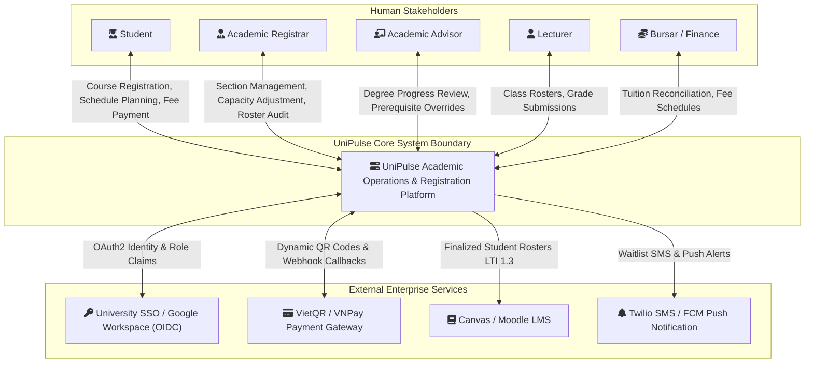
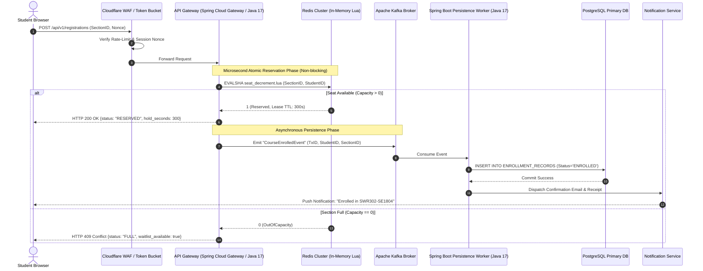
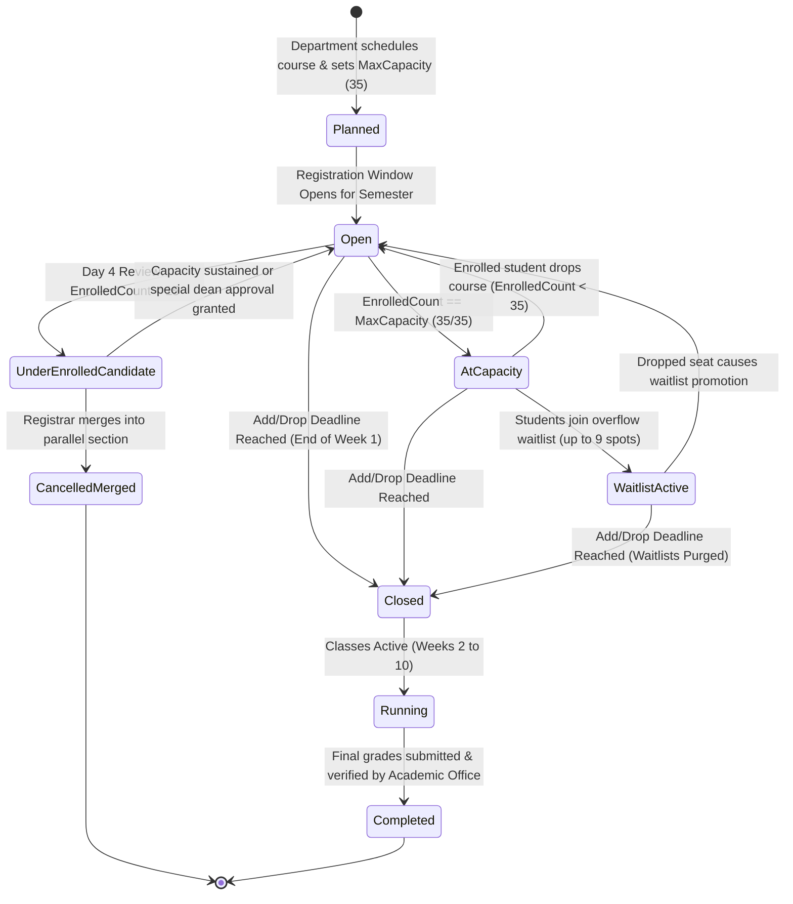
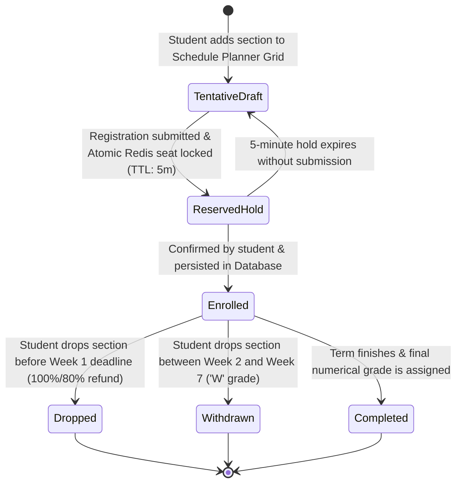
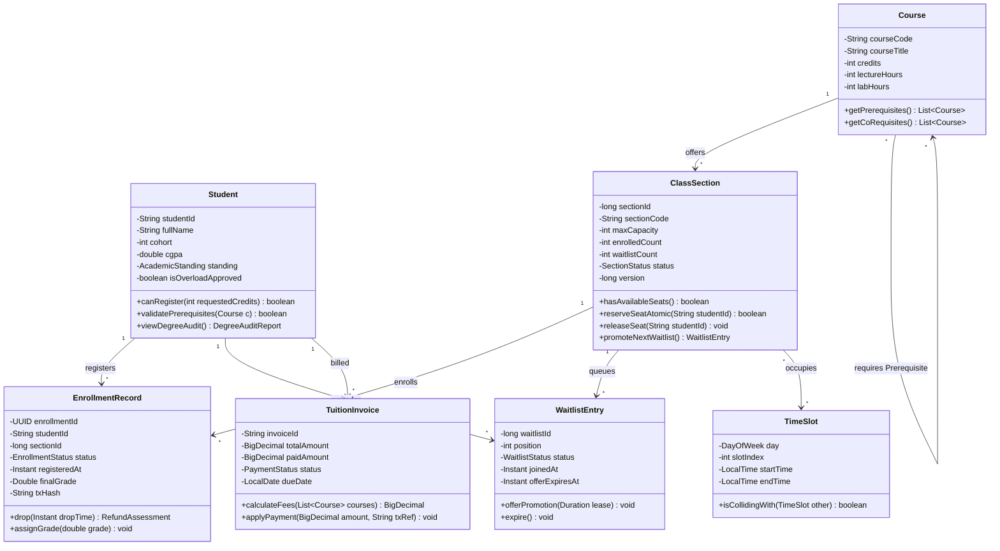

# Analysis Models
## UniPulse: Next-Generation Campus Academic & Intelligent Registration Platform
**Course:** SWR302 - Software Requirements Engineering  
**Class:** SE2059-NJ | **Team:** Assignment Group 4  
**Pedagogical Guidance:** Karl E. Wiegers & Joy Beatty (*Software Requirements*, 3rd Edition, Chapter 12: *A Picture Is Worth 1024 Words*)  
**Modeling Standard:** Unified Modeling Language (UML 2.5) Diagrams rendered in Mermaid  

---

## Table of Models
1. [System Context Diagram & Boundary](#1-system-context-diagram--boundary)
2. [Comprehensive Use Case Diagram](#2-comprehensive-use-case-diagram)
3. [High-Concurrency Registration Activity Diagram](#3-high-concurrency-registration-activity-diagram)
4. [End-to-End Registration & Seat Hold Sequence Diagram](#4-end-to-end-registration--seat-hold-sequence-diagram)
5. [Class Section Lifecycle State Machine Diagram](#5-class-section-lifecycle-state-machine-diagram)
6. [Enrollment Record State Machine Diagram](#6-enrollment-record-state-machine-diagram)
7. [Domain Model Class Diagram](#7-domain-model-class-diagram)

---

## 1. System Context Diagram & Boundary

The Context Diagram defines the operational boundary of the UniPulse platform and its interactions with external human actors and external software systems.



---

## 2. Comprehensive Use Case Diagram

Illustrates the actor interactions, primary use cases, and `<<include>>` / `<<extend>>` behavioral relationships within the academic registration subsystem.

```mermaid
flowchart LR
    %% Actors
    ActorStudent((Student))
    ActorRegistrar((Academic Registrar))
    ActorAdvisor((Academic Advisor))
    ActorFinance((Finance Officer))

    %% Use Cases
    subgraph Academic_Registration_System ["UniPulse Academic System Boundary"]
        UC01([UC-01: Plan Semester Timetable])
        UC02([UC-02: Register for Course Sections])
        UC03([UC-03: Drop Course Section])
        UC04([UC-04: Atomically Swap Sections])
        UC05([UC-05: Join Course Waitlist])
        UC06([UC-06: Settle Tuition Fees Online])
        UC07([UC-07: Review & Merge Sections])
        UC08([UC-08: Process Prerequisite Override])

        subgraph Sub_Behaviors ["Internal Included Behaviors"]
            ValidatePrereq([Validate Prerequisites DAG])
            DetectClash([Detect Time Collisions])
            AtomicSeatLock([Execute Atomic Lua Seat Lock])
            AssessTuition([Compute Assessed Fees])
            LogAudit([Record Immutable Audit Log])
        end
    end

    %% Student Relationships
    ActorStudent --> UC01
    ActorStudent --> UC02
    ActorStudent --> UC03
    ActorStudent --> UC04
    ActorStudent --> UC05
    ActorStudent --> UC06

    %% Operational Relationships
    ActorRegistrar --> UC07
    ActorAdvisor --> UC08
    ActorFinance --> UC06

    %% Includes
    UC01 -.->|<<include>>| ValidatePrereq
    UC01 -.->|<<include>>| DetectClash
    UC02 -.->|<<include>>| AtomicSeatLock
    UC02 -.->|<<include>>| AssessTuition
    UC04 -.->|<<include>>| DetectClash
    UC04 -.->|<<include>>| AtomicSeatLock
    UC08 -.->|<<include>>| LogAudit
    UC07 -.->|<<include>>| LogAudit

    %% Extends
    UC05 -.->|<<extend>>\n[if section full]| UC02
```

---

## 3. High-Concurrency Registration Activity Diagram

*Note for Course Evaluators:* This diagram details the multi-stage traffic mitigation workflow designed to handle 25,000+ concurrent requests during the initial rush without database locks or server crashes.

```mermaid
flowchart TD
    Start([Student clicks 'Submit Registration']) --> EdgeCheck{Traffic Surge > 3,500 req/s?}
    
    %% Virtual Waiting Room Path
    EdgeCheck -- Yes --> QueueTicket[Issue Signed Token Bucket Queue Ticket]
    QueueTicket --> WaitRoom[Render Virtual Waiting Room Screen with Live Countdown]
    WaitRoom --> Admitted{Queue Turn Arrived?}
    Admitted -- No --> WaitRoom
    Admitted -- Yes --> IssueToken[Issue 10-Minute Registration Pass Token]
    IssueToken --> WindowCheck
    
    %% Direct Path
    EdgeCheck -- No --> WindowCheck{Student Window Active?\n(BR-TIME-001)}
    
    WindowCheck -- No --> RejectWindow[Display 'Registration Window Not Open Yet' Countdown] --> EndFailed([Terminated])
    WindowCheck -- Yes --> CreditCheck{10 <= Total Credits <= 20?\n(BR-CRED-001)}
    
    CreditCheck -- No --> RejectCredit[Display Credit Boundary Violation Alert] --> EndFailed
    CreditCheck -- Yes --> PrereqCheck{Prerequisites Passed?\n(BR-PRE-001)}
    
    PrereqCheck -- No --> RejectPrereq[Highlight Missing Prerequisites with Appeal Option] --> EndFailed
    PrereqCheck -- Yes --> ClashCheck{Time Clash Detected?\n(FR-SCH-002)}
    
    ClashCheck -- Yes --> RejectClash[Highlight Conflicting Grid Slot in Red] --> EndFailed
    ClashCheck -- No --> ExecuteLua[Execute In-Memory Atomic Redis Lua Script]
    
    ExecuteLua --> SeatCheck{Remaining Seats > 0?\n(Atomic DECRBY)}
    
    %% Seat Available
    SeatCheck -- Yes --> LockSeat[Atomically Decrement Seat & Bind Student ID\nTTL = 5 Minutes]
    LockSeat --> AsyncKafka[Publish RegistrationConfirmedEvent to Kafka Queue]
    AsyncKafka --> WriteDB[(Worker writes to PostgreSQL with Optimistic Lock)]
    WriteDB --> UpdateTuition[Append Course Fees to Tuition Invoice]
    UpdateTuition --> SendToast[Broadcast Green Success Toast & Update Official Timetable]
    SendToast --> EndSuccess([Registration Successfully Confirmed])
    
    %% Seat Full
    SeatCheck -- No --> CheckWaitlist{Waitlist Available?\n(< 25% Capacity)}
    CheckWaitlist -- Yes --> OfferWaitlist[Prompt: 'Section Full. Join Waitlist Queue #N?']
    OfferWaitlist --> EndWaitlist([Waitlist Choice Rendered])
    CheckWaitlist -- No --> PromptAlternate[Alert: 'Section & Waitlist Full. Choose Alternate Section']
    PromptAlternate --> EndFailed
```

---

## 4. End-to-End Registration & Seat Hold Sequence Diagram

Demonstrates the asynchronous decoupled interaction between the client browser, API gateway, Redis caching tier, message broker, and relational storage.



---

## 5. Class Section Lifecycle State Machine Diagram

Models the formal states of a course section from initial semester curriculum scheduling through final grade archiving.



---

## 6. Enrollment Record State Machine Diagram

Details the state transitions of an individual student's course enrollment record.



---

## 7. Domain Model Class Diagram

Specifies the core object-oriented domain classes, structural relationships, attributes, and operational contracts.



---
*End of Analysis Models Document - UniPulse Platform*
